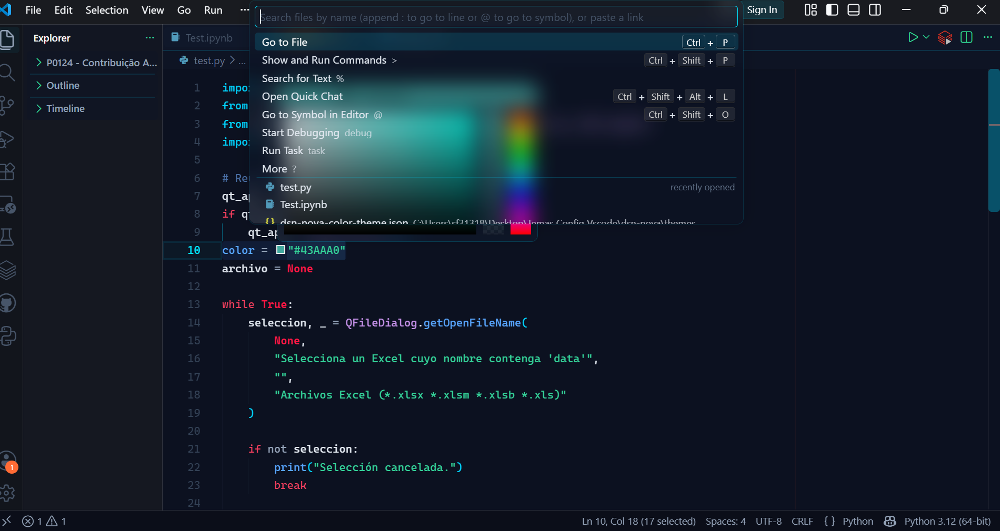

# DSN Nova

A futuristic dark theme for Visual Studio Code designed to improve code readability, visual hierarchy and programming focus.

DSN Nova combines a complete color theme with an optional Glassmorphism interface, using controlled neon accents, transparent surfaces and functional semantic colors.

> Programming first. Every color has a purpose.

---

## Features

- Complete dark interface theme
- Semantic syntax highlighting
- Optimized Python color hierarchy
- Dedicated colors for functions, classes and parameters
- High-visibility constants, booleans and `None`
- Custom terminal ANSI palette
- Git status colors
- Debugging colors
- Notebook support
- JSON and JSONC highlighting
- YAML highlighting
- Markdown styling
- Dockerfile keyword highlighting
- Optional Glassmorphism interface
- Neon focus indicators
- Enhanced Command Palette
- Custom scrollbar and cursor glow

---

## Preview



---

## Design Philosophy

DSN Nova follows four main principles.

### Programming First

The editor is the primary visual focus. Interface elements use darker surfaces while the code receives stronger semantic contrast.

### Functional Color Hierarchy

Each color has a specific function:

| Color | Purpose |
|---|---|
| Cyan | Structure, focus and navigation |
| Blue | Functions and methods |
| Purple | Classes, types and properties |
| Green | Strings and successful states |
| Orange | Numbers, decorators and active details |
| Red | Constants, errors and critical actions |
| Gold | Warnings and modified resources |

### Controlled Neon

Neon colors are used only for focus, navigation and active states. This creates a futuristic interface without affecting code readability.

### Optional Glass Experience

The standard theme works without additional configuration.

The optional `dsn-nova.css` file adds transparency, blur, illuminated borders and Glassmorphism effects to the Visual Studio Code interface.

---

## Optimized Languages

DSN Nova includes dedicated styling for:

- Python
- JSON
- JSON with Comments
- YAML
- Markdown
- Dockerfile

Other languages remain compatible through the standard Visual Studio Code token and semantic highlighting systems.

---

## Main Color Palette

| Purpose | Color |
|---|---:|
| Main background | `#0B1120` |
| Primary foreground | `#E2E8F0` |
| Focus cyan | `#00E5FF` |
| Structural cyan | `#00D4FF` |
| Function blue | `#58A6FF` |
| Class purple | `#C792EA` |
| Property violet | `#818CF8` |
| String green | `#34D399` |
| Accent orange | `#FF6B35` |
| Active red | `#FF3D21` |
| Error red | `#F43F5E` |
| Warning gold | `#F59E0B` |

---

## Installation

### Install from VSIX

1. Download the DSN Nova `.vsix` file.
2. Open Visual Studio Code.
3. Open the Extensions view.
4. Select the `...` menu.
5. Select **Install from VSIX...**
6. Choose the DSN Nova package.
7. Open the Command Palette with `Ctrl+Shift+P`.
8. Run:

```text
Preferences: Color Theme
```

9. Select **DSN Nova**.

### Install from the terminal

```bash
code --install-extension dsn-nova-x.x.x.vsix
```

Replace `x.x.x` with the version included in the package name.

---

## Optional Glassmorphism Setup

The DSN Nova color theme works without custom CSS.

The following configuration is required only if you want the complete Glassmorphism interface.

### 1. Install a Custom CSS loader

Install a Visual Studio Code extension capable of loading custom CSS, such as:

```text
Custom CSS and JS Loader
```

### 2. Store the CSS file

Keep `dsn-nova.css` in a permanent location.

Example:

```text
C:\Users\YourUser\Documents\DSN-Nova\dsn-nova.css
```

### 3. Configure Visual Studio Code

Open your Visual Studio Code `settings.json` file and add:

```json
{
    "vscode_custom_css.imports": [
        "file:///C:/Users/YourUser/Documents/DSN-Nova/dsn-nova.css"
    ]
}
```

Important:

- Use `/` instead of `\`.
- Use the complete absolute path.
- The path must begin with `file:///`.
- Keep the `.css` extension.

### 4. Enable Custom CSS

Open the Command Palette and run the enable or reload command provided by the Custom CSS loader.

Restart Visual Studio Code when requested.

---

## Recommended Settings

```json
{
    "workbench.colorTheme": "DSN Nova",
    "editor.semanticHighlighting.enabled": true,
    "editor.bracketPairColorization.enabled": true,
    "editor.guides.bracketPairs": true,
    "editor.cursorBlinking": "smooth",
    "editor.cursorSmoothCaretAnimation": "on",
    "editor.smoothScrolling": true,
    "editor.renderWhitespace": "selection",
    "editor.fontLigatures": true,
    "terminal.integrated.cursorBlinking": true,
    "workbench.list.smoothScrolling": true
}
```

---

## Recommended Fonts

DSN Nova works especially well with:

- JetBrains Mono
- Cascadia Code
- Fira Code
- IBM Plex Mono
- Geist Mono

Example configuration:

```json
{
    "editor.fontFamily": "'JetBrains Mono', 'Cascadia Code', monospace",
    "editor.fontSize": 14,
    "editor.lineHeight": 22,
    "editor.fontLigatures": true
}
```

Fonts are not included with DSN Nova and must be installed separately.

---

## Troubleshooting

### The theme works, but the Glass effect is not visible

Confirm that:

1. The Custom CSS loader is installed.
2. The CSS path is absolute.
3. The path begins with `file:///`.
4. Forward slashes are used.
5. The CSS loader was enabled.
6. Visual Studio Code was restarted.

### The Glass effect disappeared after an update

Visual Studio Code updates may disable Custom CSS modifications.

Run the enable or reload command from the Custom CSS loader again and restart Visual Studio Code.

### Visual Studio Code reports a corrupted installation

Some Custom CSS loaders modify internal Visual Studio Code files. This can cause an integrity warning.

The warning is related to the CSS loading mechanism, not to the DSN Nova color theme.

You can use DSN Nova without the optional CSS layer if you do not want this behavior.

### Python colors do not appear correctly

Enable semantic highlighting:

```json
{
    "editor.semanticHighlighting.enabled": true
}
```

Also confirm that the official Python extension is enabled.

### The CSS stopped working after moving the file

Update the path configured in:

```json
"vscode_custom_css.imports"
```

Then enable or reload the Custom CSS again.

---

## Compatibility

The base color theme uses the official Visual Studio Code color theme structure.

The optional CSS layer depends on internal Visual Studio Code selectors. Some effects may require adjustments after major Visual Studio Code updates.

---

## Known Limitations

- Visual Studio Code does not natively support custom workbench CSS.
- Glassmorphism requires an external CSS loader.
- Internal Visual Studio Code selectors may change after updates.
- Transparency may look different depending on the operating system.
- Blur effects may increase GPU usage.
- The CSS layer may need to be enabled again after updating Visual Studio Code.

---

## Security Notice

Custom CSS loaders inject styles into the Visual Studio Code interface.

Review the loader extension and the `dsn-nova.css` file before enabling them.

The CSS layer is optional and is not required to use the DSN Nova color theme.

---

## Feedback

When reporting an issue, include:

- Visual Studio Code version
- Operating system
- DSN Nova version
- Custom CSS loader name and version
- Screenshot of the issue
- Relevant Visual Studio Code settings

---

## License

This project is distributed under the MIT License.

See the `LICENSE` file for more information.

---

## Author

Created by Leonardo Trujillo.

Designed for a modern, focused and immersive programming experience.

---

## Disclaimer

DSN Nova is an independent Visual Studio Code theme and is not affiliated with Microsoft.

Visual Studio Code is a trademark of Microsoft Corporation.